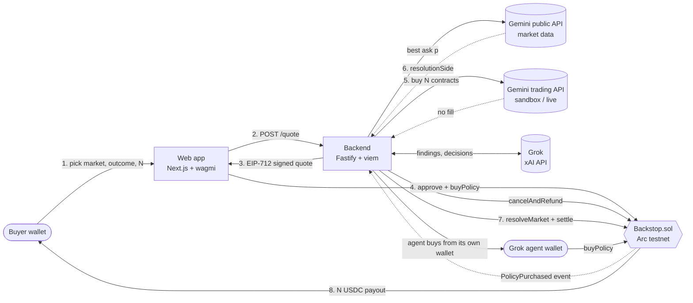
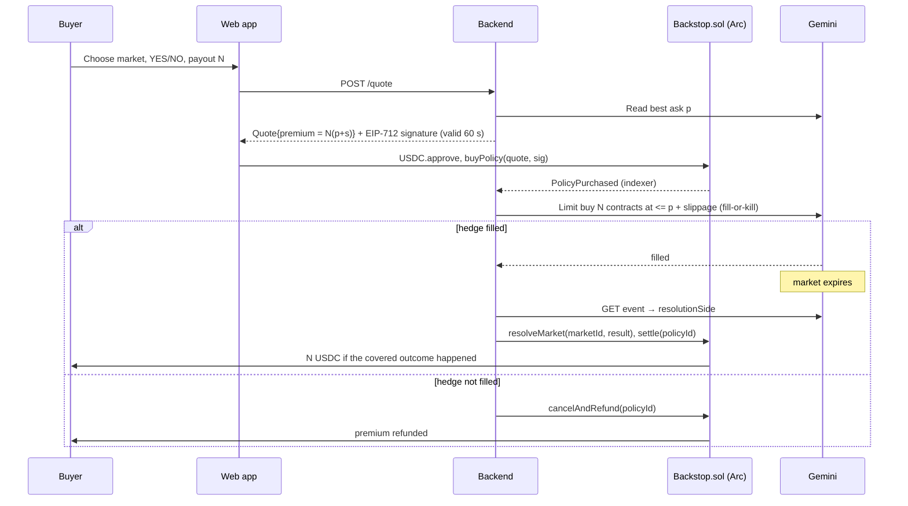

# Backstop

**Hedge a real-world event in one click.** Buy cover in USDC on Arc; Backstop prices it from Gemini's live prediction-market odds and hedges it by buying the matching Gemini contracts. If the event happens, the smart contract pays you.

> UBC 2026 Hackathon<br>
> Track: DeFi and Onchain Applications<br>
> Chain award: Best use of Arc<br>
> Bounties: Gemini Prediction Markets, Grok Bot

**Live app:** https://backstop-hq.vercel.app<br>
**Backend API:** https://backstop-production-0e6db23c.up.railway.app/health<br>
**Demo video:** _added after recording_<br>
**Contract:** [`0x3c7c…4A05` on Arc testnet](https://explorer.testnet.arc.io/address/0x3c7cdb6658BbcE924dCBD6327FCc5B72B3624A05)

| | |
|---|---|
| **What** | Parametric event cover: pay a USDC premium onchain, receive N USDC if a real-world outcome happens. |
| **Priced by** | Gemini Prediction Markets live order book: premium = N × (p + s). |
| **Backed by** | A matching Gemini position bought for every policy. The prediction market is the oracle *and* the reinsurer. |
| **Settled on** | Arc, Circle's L1 where USDC is the gas token and the settlement asset. |
| **Run by** | A Grok agent with its own wallet that screens the markets and buys cover on its own, within hard limits. |

## Grok's role

Grok is Backstop's hedging agent: it holds its own Arc testnet wallet and buys cover with no human signature. In the chat ("protect my ETH against a drop in the next hour") it screens the live Gemini markets with tools, explains its pick and buys the policy onchain. On autopilot it reviews every screener finding against a valued portfolio and decides to buy or hold, with a short, numbers-based reason for each decision that is shown in the app's activity feed. The server enforces its limits and re-checks every pick, so Grok decides but can't exceed the per-policy cap, the daily budget or the hedge rules. A chat export is in [`docs/grok-agent-chat-export.md`](docs/grok-agent-chat-export.md).

## Repo layout

```
contracts/   Foundry project: Backstop.sol + tests + deploy script
docs/        Grok agent chat export
backend/     Node/TypeScript service: Gemini client, quote signer, hedger, resolver, Grok agent
web/         Next.js app: market picker, live premium, buy flow, policy timeline
Dockerfile   Backend container (Railway or any Docker host)
```

## Architecture



**Policy lifecycle**



Components:
- **`contracts/`**: `Backstop.sol` holds the USDC treasury, verifies signed quotes, locks each payout, and settles. It trusts the backend for two things only (signing quotes and posting results), and both are bounded (see Risk assumptions).
- **`backend/`**: one Node process with an HTTP API and three workers: indexer (Arc events → SQLite), hedger (Gemini orders) and resolver (Gemini results → Arc).
- **`web/`**: a single-page app for picking a market, buying cover and tracking policies.

## Deployed contracts (Arc testnet, chain ID 5042002)

| Contract | Address |
|---|---|
| USDC (ERC-20, 6 decimals, official Circle) | [`0x3600000000000000000000000000000000000000`](https://explorer.testnet.arc.io/address/0x3600000000000000000000000000000000000000) |
| Backstop (verified source) | [`0x3c7cdb6658BbcE924dCBD6327FCc5B72B3624A05`](https://explorer.testnet.arc.io/address/0x3c7cdb6658BbcE924dCBD6327FCc5B72B3624A05) |

Roles: owner `0x6D40a8B185B74574052c58Bb322618eE543a366b`, quote signer `0x87bCbF155ab2e4729D6eE7F2feff3a26600936C2`, resolver `0x91cD37e12d6dD26ac9c98af21d346DF9502C55b7`, Grok agent wallet [`0x4B0dE4147948fE97a1b53086F15C919348344F78`](https://explorer.testnet.arc.io/address/0x4B0dE4147948fE97a1b53086F15C919348344F78).
Demo config: max payout 20 USDC per policy, max exposure 50 USDC per market, refund grace period 24 h. Treasury seeded with 12 USDC, topped up to about 95 USDC free liquidity on Nov 18 ([deposit tx](https://explorer.testnet.arc.io/tx/0xbcc5d985167dd9b9d7c78e0b76f14aea0dd56a7ae639e2be2930e291f1d5b16b), [caps tx](https://explorer.testnet.arc.io/tx/0xb159d532218c02a16bc2a4feeb68d59b847d3f129a9e1aa389faf0c467870314)).

## Verified on Arc testnet

Every path has run end to end against the deployed contract:

| Policy | Hedge | Result | Transaction |
|---|---|---|---|
| #1 | simulated fill | covered outcome happened → **paid out 2 USDC** | see contract history |
| #2 | forced failure | hedge failed → **premium refunded** | see contract history |
| #3 | **real Gemini sandbox order**: 2 YES filled at 0.43 on `GEMI-BTC2611170400-HI64400` | **paid out 2 USDC** | [`0x69f4…2af4b`](https://explorer.testnet.arc.io/tx/0x69f46ec1a9340f796aef8d6e5b3ed2cea0cc17547eee94e22c731f3a585af2b4) |
| #4 | real Gemini sandbox fill-or-kill order, not filled (sandbox ask 0.97 > limit 0.12) | **premium refunded** | [`0xa571…e32c`](https://explorer.testnet.arc.io/tx/0xa571ad0977a4543ecb0169fadac198bf502328b72b0280ac25aac2884b3ce32c) |

The Grok agent, buying from its own wallet:

| Policy | How | Hedge | Transaction |
|---|---|---|---|
| #12 | **autopilot**: "Hedging 1% BTC drop… strike −0.22% of spot, 0.44 per $1 vs ~41% odds" | Gemini sandbox, 6 NO filled at 0.40 | [`0xd6ea…1bf65`](https://explorer.testnet.arc.io/tx/0xd6eae4df91f043615d7fbb3d937f2c85e0c56b26c6f42df181c2429e36bf1f65) |
| #15 | **chat**: "protect my ETH against a drop in the next hour with about 3 USDC" | Gemini sandbox | [`0x0a6a…5af5e`](https://explorer.testnet.arc.io/tx/0x0a6ac9358536208f324d395050031d46589f7f19f684fbaac3c98e893b05af5e) |

Treasury accounting checks out: 12 USDC seed + 1.06 + 1.12 premiums − 2 − 2 payouts = 10.18 USDC free, 0 locked.

## Smart contract

`contracts/src/Backstop.sol` (Solidity 0.8.24, OpenZeppelin 5.1).

- **Quotes** are EIP-712 typed data signed by the backend's `quoteSigner`:
  `Quote(address buyer, bytes32 marketId, uint8 outcome, uint256 payout, uint256 premium, uint64 quoteExpiry, uint64 resolveBy, uint256 nonce)`, where `marketId = keccak256(instrumentSymbol)` and `outcome` is 1 = YES, 2 = NO.
- `buyPolicy` checks the signature, sender, expiry, nonce, symbol hash, `premium < payout`, the per-policy and per-market caps, and that free liquidity covers the payout. It then pulls the premium and **locks the full payout**.
- `resolveMarket` (resolver only, once per market) and `settle` (anyone) pay the buyer if their outcome happened, otherwise mark the policy Expired. Liquidity is unlocked either way.
- `cancelAndRefund` (resolver only) refunds the premium when the Gemini hedge can't be filled.
- `claimRefund` lets the buyer recover the premium if the market is still unresolved after `resolveBy + refundGracePeriod`. This protects buyers if the relayer goes down.
- `withdrawTreasury` can only move **free** liquidity. Funds locked for open policies can never leave.

Invariant: `lockedLiquidity ≤ USDC balance`, and every open policy is always fully payable (or refundable, since `premium < payout`).

### Run the tests

```bash
cd contracts
forge test -vv
```

28 tests cover: payout, losing policy, NO-side cover, bad and tampered signatures, expired quote, replayed nonce, wrong sender, symbol mismatch, caps, insufficient liquidity, cancel and refund, timeout refund, treasury withdrawal against locked funds, admin access control, signer rotation, plus a fuzz test of the liquidity accounting.

## Setup

Requirements: Foundry, Node 22+, pnpm (`corepack pnpm` works without a global install).

```bash
git clone --recurse-submodules <repo>
cd backstop
cp .env.example .env   # fill in keys
cd contracts && forge test
```

### Deploy to Arc testnet

```bash
set -a; source .env; set +a
cd contracts
TREASURY_SEED_USDC=0 forge script script/Deploy.s.sol --rpc-url "$ARC_RPC_URL" --broadcast

# seed the treasury with real-node calls (see note below)
cast send $USDC_ADDRESS 'approve(address,uint256)' $BACKSTOP_ADDRESS 12000000 --private-key $PRIVATE_KEY_DEPLOYER --rpc-url $ARC_RPC_URL
cast send $BACKSTOP_ADDRESS 'depositTreasury(uint256)' 12000000 --private-key $PRIVATE_KEY_DEPLOYER --rpc-url $ARC_RPC_URL

# verify on the Arc explorer (Blockscout)
forge verify-contract $BACKSTOP_ADDRESS src/Backstop.sol:Backstop --chain-id 5042002 \
  --verifier blockscout --verifier-url https://explorer.testnet.arc.io/api/ \
  --constructor-args $(cast abi-encode "constructor(address,address,address,uint256,uint256,uint64)" \
  $USDC_ADDRESS <signer> <resolver> 5000000 12000000 86400)
```

> **Arc note:** Arc's USDC ERC-20 is backed by the native gas balance through a system precompile. Forge's local script simulation can't execute USDC calls (it fails with `StackUnderflow`), so token transfers in setup scripts go through `cast send`, which runs on the real node. Contract deployment through `forge script` works normally.

## How Backstop uses Arc

- **USDC is the gas token and the settlement asset.** A buyer needs one balance, in dollars, for everything: the premium, the approval and the gas. There's no volatile gas token to buy first, which matters for an insurance product sold to non-crypto users.
- **Official Circle USDC.** The contract holds and pays out the canonical USDC ERC-20 at `0x3600…0000` (6 decimals). Arc's native balance is the same USDC at 18 decimals, so the app shows a single balance.
- **Predictable, dollar-denominated fees.** Gas is paid in USDC, so the cost of buying a $2 policy is known up front. This is what makes small, frequent, short-expiry cover (5- and 15-minute markets) viable.
- **Fast finality fits short windows.** A policy on a 5-minute market has to be bought, indexed and hedged within seconds. On Arc, the purchase is confirmed and the hedge is placed well inside the quote's 60 s validity.
- **The treasury is a USDC float on Arc.** Every open policy's payout is locked in the contract, and the operator can't withdraw locked funds. Payouts never depend on an offchain transfer arriving in time.
- **Arc-specific engineering notes.** USDC ERC-20 calls go through a system precompile that Forge's local simulation can't execute (documented under Deploy). The web app adds Arc Testnet to the wallet automatically with USDC as the native currency.

## Economic design

Backstop sells **parametric event cover** that is fully backed by an offsetting prediction-market position. The prediction market serves as both the price oracle and the reinsurer, so there's no underwriting pool and no actuarial model.

| Symbol | Meaning |
|---|---|
| N | payout in whole USDC = number of Gemini contracts bought as the hedge |
| p | Gemini best ask for the covered outcome (`prices.buy.yes` or `prices.buy.no`), 0 to 1 |
| s | protocol spread (`SPREAD`, default 0.03) |

- Premium = N × (p + s)
- Hedge cost = N × p
- Protocol margin = N × s
- If the covered outcome happens, N contracts settle at $1 each = N USDC, which funds the onchain payout.

Example: N = 100, p = 0.27, s = 0.03 → premium 30 USDC, hedge 27, margin 3. If the event happens, the 100 contracts pay $100, which covers the 100 USDC payout.

Covering YES buys YES contracts; covering NO buys NO contracts. All math is done in integer USDC base units (6 decimals). Quotes are refused when p + s ≥ 1, because cover would then cost more than it pays.

**Gemini fees.** Gemini's taker fee is `0.07 × C × P × (1 − P)` ([fee schedule](https://www.gemini.com/fees/predictions)), which peaks at $0.0175 per contract at P = 0.5. The 3% spread covers the worst-case taker fee with room for slippage. Hedge orders are limit orders capped at p + `MAX_SLIPPAGE` (default 0.02). Note that a fill above the quoted p eats into the margin.

**Capital.** Onchain, every open policy locks its full payout from the treasury float. Offchain, the hedge costs N × p. The float is returned when the Gemini position settles at $1, and the operator rebalances USD → USDC.

## Risk assumptions

- **Trusted relayer.** The backend signs quotes and reports resolutions, so it is a trusted oracle in this prototype. Mitigations: quotes are EIP-712 signed, single-use (nonce), short-lived (60 s) and bound to the buyer. Resolution can be posted once per market and only by the `resolver` role. Future work: multiple signers, or a proof of the Gemini API response (zkTLS).
- **Hedge execution risk.** The Gemini order may fill worse than quoted, or not at all. Mitigations: a 60 s quote validity, a limit price capped at p + `MAX_SLIPPAGE`, `fill-or-kill` by default (no partial hedges), and an automatic onchain premium refund (`cancelAndRefund`) whenever the hedge doesn't fill.
- **Settlement float.** Gemini settles in USD offchain, while payouts are USDC onchain. The contract holds a USDC float that is locked against each open policy, and the owner can only withdraw free (unlocked) funds. The operator rebalances after Gemini settlement.
- **Custodial hedge venue.** All hedge positions sit in one Gemini account.
- **Exposure caps.** `maxPayoutPerPolicy` and `maxExposurePerMarket` bound the damage from any single failure.
- **Dead relayer.** If a market is still unresolved `refundGracePeriod` (24 h) after `resolveBy`, the buyer can call `claimRefund` and recover the premium without the backend. Voided Gemini markets fall back to this path.
- **Timing.** Quotes are refused within `MIN_SECONDS_TO_EXPIRY` (45 s) of a market closing, so the hedge has time to fill before trading stops.

## Backend

`backend/` is Node 22+ with TypeScript (run with `tsx`), Fastify, viem, and SQLite (`node:sqlite`, so there are no native deps).

| Module | Role |
|---|---|
| `gemini/public.ts` | Public Gemini Prediction Markets API (no key): events, contracts, best asks, resolution |
| `gemini/private.ts` | Authenticated client on the official `@gemini-markets/sdk` (HMAC-SHA384): terms, orders, positions |
| `hedge/venue.ts` | One `HedgeVenue` interface for `HEDGE_MODE` = `simulated` / `sandbox` / `live` |
| `quotes.ts` | `POST /quote`: prices from the live ask, runs onchain cap and liquidity pre-checks, signs the EIP-712 quote |
| `indexer.ts` | Polls Backstop events on Arc into SQLite |
| `hedger.ts` | Buys N contracts of the covered outcome for each new policy; on failure calls `cancelAndRefund` |
| `resolver.ts` | Polls Gemini for `resolutionSide` after expiry, then calls `resolveMarket` and `settle` |
| `assist.ts` | Optional cover assistant: Grok (xAI) turns a plain-English risk into a suggested market, side and payout |
| `agent.ts` | Optional Grok agent: buys cover from its own testnet wallet through one guarded function (per-policy cap, daily budget, balance check, one at a time), runs standing watches, and keeps an activity log |
| `chat.ts` | Chat with the agent: Grok calls tools (`screen_markets`, `agent_status`, `buy_cover`, `start_watch`, `stop_watch`, `recent_activity`); every call is returned as a visible step, and a reply that claims a purchase without a confirmed `buy_cover` call is sent back to Grok |
| `autopilot.ts` | Grok autopilot, a portfolio-aware hedger. The agent holds a hypothetical portfolio (default 0.01 BTC, 0.3 ETH) valued at Gemini spot (`/v1/pubticker`). On each relevant finding (and every 5 min) the server builds the candidate hedges with the numbers that matter (strike vs spot, cost per $1, implied odds, a size matched to a 1% loss on the holding) and keeps only sound ones: downside cover, strike from −1.5% to +0.3% of spot, cost 0.12–0.60 per $1, at most 1.5× the suggested size, one policy per asset, and hedgeable on the Gemini venue within 2¢. Grok picks one or holds, citing those numbers; the server re-checks the pick before buying |
| `jobs.ts` | The agent's background jobs every 30 s: market screener (price jumps, cheap tail cover, new windows), on-chain watcher (agent policies and treasury on Arc), and watches that buy when conditions match |

API: `GET /markets`, `POST /quote`, `POST /assist`, `GET /agent`, `POST /agent/run`, `POST /agent/chat`, `GET /agent/activity`, `POST /agent/watches/:id/stop`, `GET /policies/:address`, `GET /policy/:id`, `GET /config`, `GET /stats`, `GET /health`.

**Hedge modes.** Market data always comes from Gemini production.
- `simulated` sends no order. It records a fill at the live production ask if that ask is within the limit price, and otherwise fails, which triggers the refund path. Set `SIMULATE_HEDGE_FAILURE=true` to force the refund path for a demo.
- `sandbox` places real orders on `api.sandbox.gemini.com`. The sandbox has its own order books, so: (1) where the sandbox trades a market, quotes are refused when its ask is more than `MAX_SLIPPAGE` above the quoted production ask ("only sell cover you can hedge"), and the market table dims those sides; (2) markets the sandbox doesn't trade (weather, sports, most commodities, and crypto ladders with empty sandbox books) are hedged on the simulated venue at the production ask, and the policy timeline labels them `simulated`. In `live` mode every hedge goes to Gemini production.
- `live` places real production orders, capped at `MAX_LIVE_CONTRACTS` (default 5).

### Gemini integration notes (verified this week)

- **Sandbox supports prediction-market orders.** `api.sandbox.gemini.com` accepts `POST /v1/prediction-markets/order`. It lists the same instrument symbols as production but has its own order books and prices. `pnpm gemini:check --env sandbox --order` places one 1-contract buy at $0.01 and cancels it.
- **Order IDs are 64-bit** (e.g. `145853902320512524`), larger than JavaScript's safe-integer range. The SDK returns them as `bigint`; the backend stores them as strings and never turns them into a JS `number`.
- **Minimum order size.** A 0.01-contract order at $0.01 is rejected with `InvalidInput`; 1 contract at $0.01 is accepted.
- **Resolution is public.** `GET /v1/prediction-markets/events/{ticker}` reports `resolutionSide: "yes" | "no"` about 5 s after expiry, so resolution needs no API key.
- **Empty books before a window opens.** A 5-minute contract quotes 0.99 on both sides before its window opens. `/markets` hides such contracts.

### Run it

```bash
corepack pnpm install
cd backend
corepack pnpm start                                   # API + workers on :8787
corepack pnpm e2e --outcome auto --payout 2           # full loop against Arc testnet
```

The e2e script picks the next priced BTC 5-minute market, gets a signed quote, approves USDC, calls `buyPolicy`, then follows the policy through hedge → Gemini resolution → onchain payout or expiry.

## Web app

`web/` is Next.js 16 (App Router) with wagmi 3, viem and Tailwind 4. Pages: `/` buy cover (markets, cover panel, wallet), `/agent` the Grok agent (chat, running jobs, activity), `/cover` your policies, `/how` how it works.

- **Ask Grok**: describe a risk in plain English ("I hold BTC and I'm worried it drops in the next hour"). Grok picks the market, side and payout that offset it and fills in the cover panel. It only suggests: the buyer reviews and signs the purchase. The backend checks every suggestion against the live market list and the payout limits, and rate-limits requests. Set `GROK_API_KEY` to enable it; `pnpm assist:check` tests it against sample markets.
- **Grok agent section**: a chat styled after the Grok app. Tell it what you hold or fear and it screens the markets and buys cover from its own wallet, or starts a standing watch ("keep me covered on every 15-minute window while it's under 0.55"). Next to the chat, the running jobs (market screener, on-chain watcher, watches) and a live activity feed show what it found and did, with Arc transaction links. `MOCK_MARKETS=true` serves sample markets for local development when Gemini is down; it refuses to run in production, and purchases still need real Gemini prices.
- **Grok agent (one click)**: "Let Grok buy it" has the agent act on the request by itself. Grok chooses the policy, then the backend buys it on Arc from the agent's own testnet wallet (`PRIVATE_KEY_AGENT`) with no human signature. Limits: `AGENT_MAX_PAYOUT` per policy, `AGENT_DAILY_BUDGET_USDC` per UTC day, a balance check, one purchase at a time, and an on/off switch (`AGENT_ENABLED`). Every decision, including declines and blocked purchases, is logged with Grok's reasoning and shown on the page with the agent's policies tracked to settlement.
- **Get cover**: live Gemini markets grouped by horizon (5 min, 15 min, hourly, daily+) and asset. Tap YES or NO, choose a payout, and the ticket shows the premium live as `N × (p + s)`, with the hedge cost and protocol margin.
- **Buy flow**: one click runs signed quote → USDC approve (only if needed) → `buyPolicy`, with a visible step for each and the 60 s quote validity.
- **My cover**: every policy for the connected wallet with a four-step timeline (purchased → hedged on Gemini → resolved → paid out / expired / refunded), each linked to its Arc transaction.
- **How it works**: pricing, hedging, the worked example, and the buyer protections.

Design: a dark trading-app interface (Schibsted Grotesk and Geist Mono, hairline borders, green and red only for YES/NO and paid/failed states). All design tokens live in `web/src/app/globals.css`.

Wallets: any injected wallet (MetaMask, Rabby). The app offers to add and switch to Arc Testnet. Test USDC comes from [faucet.circle.com](https://faucet.circle.com).

```bash
cd web
cp .env.example .env.local      # NEXT_PUBLIC_BACKSTOP_API, default http://localhost:8787
corepack pnpm dev               # http://localhost:3000
```

## Grok agent: decision loop and safety limits

**Decision loop** (every 30 s, `backend/src/jobs.ts` → `autopilot.ts`):
1. **Screen.** Read ~170 live Gemini markets; flag price moves ≥ 8¢, cheap cover (0.05–0.15) and new windows. Watch the agent's policies and the treasury on Arc.
2. **Value the portfolio.** Hypothetical holdings (default 0.01 BTC, 0.3 ETH) at Gemini spot (`/v1/pubticker`).
3. **Build candidates.** For each uncovered holding: crypto markets with a known strike, with strike vs spot, cost per $1 (ask + spread), implied odds, and a size equal to the loss on a 1% drop.
4. **Filter by rules.** Downside cover only; strike −1.5% to +0.3% of spot; cost 0.12–0.60 per $1; ≥ 3 min left; hedgeable on the Gemini venue within 2¢.
5. **Decide.** Grok (structured output) picks one candidate or holds, and must cite the numbers. Every decision is logged and shown in the app.
6. **Re-check and buy.** The server re-validates the pick (size ≤ 1.5× suggested, asset not already covered, live price ≤ decided price + 2¢) and buys through the same signed-quote → `buyPolicy` path as a human.

**Safety limits:**
- 10 USDC max payout per policy
- 25 USDC of premiums per UTC day (refunds don't count)
- Balance check
- One purchase at a time
- One open policy per asset
- At most one decision per 45 s
- On/off switch (`AGENT_ENABLED`, and the autopilot toggle in the app)
- Chat purchases only on an explicit request, with a server-side guard that disables buying when the user says not to buy
- The contract's own per-policy and per-market caps.

## Technologies and sponsor tools

- **Arc (Circle):** Arc testnet, USDC as gas and settlement, official USDC ERC-20, Arc explorer (Blockscout) for verification
- **Gemini Prediction Markets:** market data and resolution (public API), trading on the sandbox via `@gemini-markets/sdk`, public ticker for spot prices
- **Grok (xAI API):** `grok-4.20` with structured outputs and tool calling
- **Contracts:** Solidity 0.8.24, Foundry, OpenZeppelin 5.1
- **Backend:** Node 24, TypeScript, Fastify, viem, zod, SQLite
- **Web:** Next.js 16, React 19, wagmi 3, viem, TanStack Query, Tailwind CSS 4

## Deployment

| Part | Where | How |
|---|---|---|
| Contract | Arc testnet | `forge script` (see above) |
| Backend | Railway (any Docker host works) | Root `Dockerfile`. Set the env vars from `.env.example` as service variables and mount a volume at `/data` for the SQLite index. |
| Web | Vercel | Root directory `web/`, framework Next.js, env `NEXT_PUBLIC_BACKSTOP_API=<backend URL>` |

Run **one** backend with workers at a time. Two backends with workers would both hedge and resolve the same policies. Set `RUN_WORKERS=false` on any extra API-only instance.

Policy status can always be rebuilt from Arc events, starting at `BACKSTOP_DEPLOY_BLOCK`. Hedge records (Gemini order IDs and fills) exist only in SQLite, so keep it on a persistent volume.
